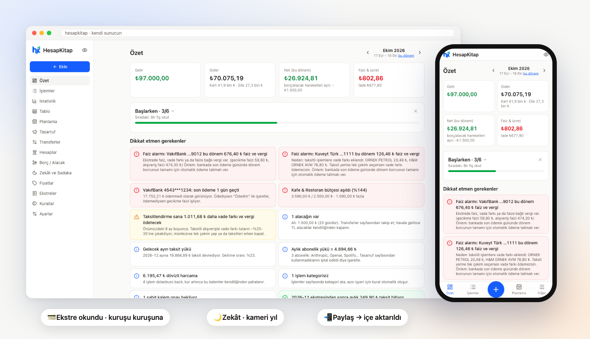

<p align="center">
  
</p>

<h1 align="center">HesapKitap</h1>

<p align="center">
  <b>Drop your bank statement, HesapKitap does the rest — and your data stays with you.</b><br>
  Self-hosted personal finance built for Turkish banks: statement reading, snap-a-receipt, budgets and forecasts,<br>
  price tracking, savings jars, interest alarm, a shared household book — and zakat too.
</p>

<p align="center">
  <a href="https://hesapkitap.alameddinc.com"><b>🧪 Live demo</b></a> — try it without installing: sample data, your own private copy for 1 hour
</p>

<p align="center">
  <a href="README.md">🇹🇷 Türkçe</a> · <b>🇬🇧 English</b> ·
  <a href="docs/KURULUM.md">Install guide (TR)</a> ·
  <a href="https://github.com/alameddinc/hesapkitap/issues/new/choose">Report an issue</a>
</p>

<p align="center">
  
</p>

> 🧪 **Beta.** The app's interface is in **Turkish**; issues and pull requests in English are welcome.

## Why

Turkish banks don't offer open-banking APIs to individuals, and generic finance apps don't understand Turkish credit card
statements: installments (*taksit*), cut-off and due dates, interest plus BSMV/KKDF taxes, foreign-currency lines,
supplementary cards. HesapKitap reads the PDFs and exports your bank already gives you, **verifies them to the cent**,
and turns them into a monthly picture, a forecast and reminders — on your own server.

## Highlights

- **Reads what your bank gives you** — credit card statements (PDF/Excel), account exports (PDF/Excel/CSV), transfer
  receipts, shop receipts and utility bills. One drop zone; it figures out what each document is and asks when unsure.
- **Verified, not guessed**
  - Card statements must satisfy the *statement equation*: previous balance − payments + charges = statement balance.
  - Account exports must satisfy the *balance chain*: every row's previous balance + amount = new balance.
  - If it doesn't add up, it isn't imported silently.
- **Learns new banks without AI**
  - Ready-made parsers for VakıfBank and Kuveyt Türk.
  - Other banks: a generic reader tries date and number formats, amount columns and payment signs until the equation
    holds, then saves that layout as a small template (no personal data) and can share it with the community.
  - Optional Gemini fallback.
- **Snap a receipt, done** — merchant, total, line items, installments and the card's last 4 digits are filled in for
  you. Works with local OCR (Tesseract, Turkish) so the photo never leaves your server, or with Gemini if you add a key.
- **Smart shopping**
  - Price tracking from your receipts: where you bought it cheapest, how prices moved.
  - *"What if I buy it?"* simulator: installment and surcharge cost, effect on the coming months.
  - Subscription audit and savings goals.
- **Plan ahead**
  - Open card cycle: what you've spent so far and the likely amount at cut-off.
  - Installment schedule and recurring items (rent, salary from gross to net with Turkish payroll tax).
  - Suggestions for payments that repeat every month, and a cash-flow forecast.
- **Interest alarm** — explains *why* you were charged interest (late payment, partial payment, installment surcharge).
- **Shared household book** — invite your spouse to the same book; hide specific cards, accounts, interest, pages or
  single transactions from them. Hiding is enforced on the server, not just in the UI.
- **Phone-first**
  - Installable PWA and the share sheet on Android/iOS.
  - A one-tap *"Snap receipt"* iOS shortcut (lock screen, Action button, Back Tap).
- **Zakat and charity**
  - Per-person nisab on the lunar year, gold and foreign currency, missed past years.
  - Ramadan, fitra and Qurban reminders.
- **Undo any upload**, a suspicious-change check (balance dropping to zero, huge jumps), a month-end digest and a
  yearly summary.
- **Your data**
  - SQLite, one file per user.
  - Daily backups, an encrypted off-site copy over Telegram, download everything as a zip or Excel, restore in one click.

## Quick start

```bash
docker run -d --name hesapkitap -p 8080:8000 -v hesapkitap:/app/data -e TZ=Europe/Istanbul \
  ghcr.io/alameddinc/hesapkitap:latest
```

Open `http://YOUR-SERVER:8080` and set a password. If you're not on the same machine, the setup code is in
`docker logs hesapkitap`. Images are multi-arch (amd64 + arm64: Raspberry Pi, Apple Silicon, home servers).

Other options:
- One-click deploy to Render, Railway or Fly.io.
- CasaOS and Unraid templates.
- A plain `docker compose` file in [`deploy/`](deploy/).

See [docs/KURULUM.md](docs/KURULUM.md) (Turkish, but the commands speak for themselves).

## Privacy

Everything runs on your server and is stored in SQLite files you own. Nothing is sent anywhere unless you turn it on:

| You enable | What it sends |
|---|---|
| A Gemini key | Documents that need AI reading go to Google |
| Telegram | Notifications and the encrypted backup go to your own bot |
| Template sharing (on by default, can be turned off) | Only a bank's layout (date format, which column is the amount). Never names, card numbers, amounts or descriptions. |

## Help wanted: your bank

If your bank's statement isn't read, you can help **without sharing the document**:

```bash
python -m app.card_reader statement.pdf            # where it fails (no names, card numbers or amounts)
python -m app.card_reader statement.pdf --anonim   # same layout, personal data masked
```

Paste the output into a ["My bank isn't read" issue](https://github.com/alameddinc/hesapkitap/issues/new/choose).
Tracking: [#1](https://github.com/alameddinc/hesapkitap/issues/1) (Ziraat, Garanti BBVA, İş Bankası, Yapı Kredi,
Akbank, QNB).

## Tech

- **Backend:** FastAPI, SQLite, pdfplumber, Tesseract.
- **Frontend:** React 19, Vite, Tailwind, TanStack Query, Recharts.
- **Quality:** around 230 tests, CI on every push.

See [CONTRIBUTING.md](CONTRIBUTING.md).

## License

[PolyForm Noncommercial 1.0.0](LICENSE): free for personal and other noncommercial use. Commercial use requires
permission.

The "HesapKitap" name and logo belong to the project owner and are not covered by the license; forks that are
distributed must use a different name and logo.
