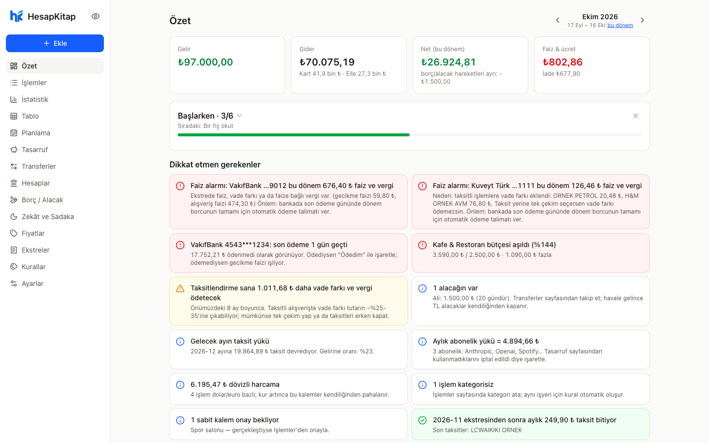
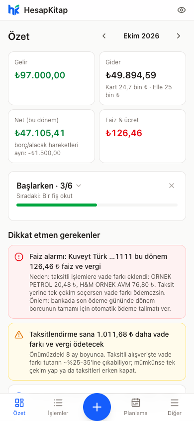
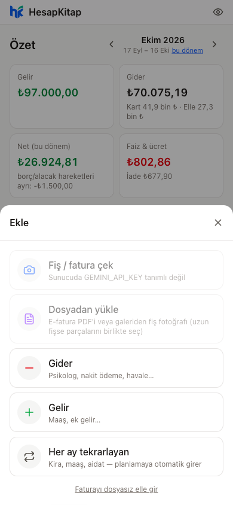
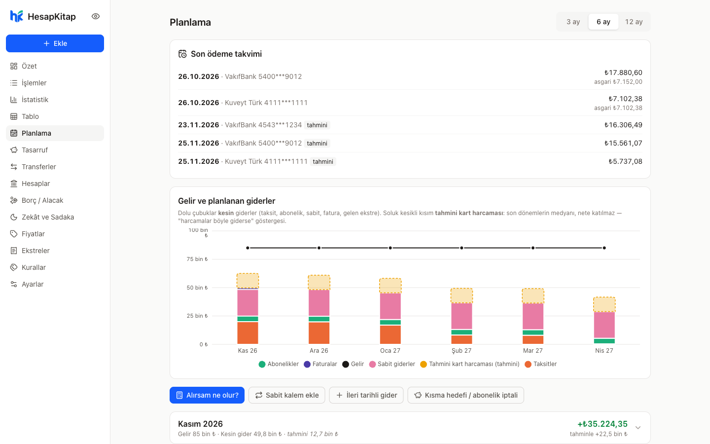
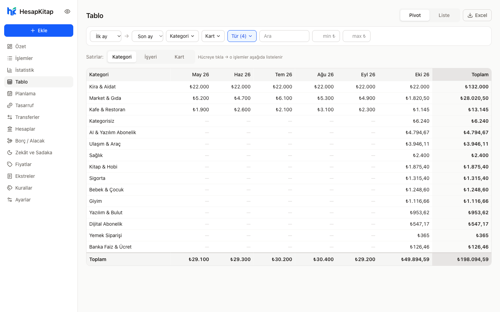
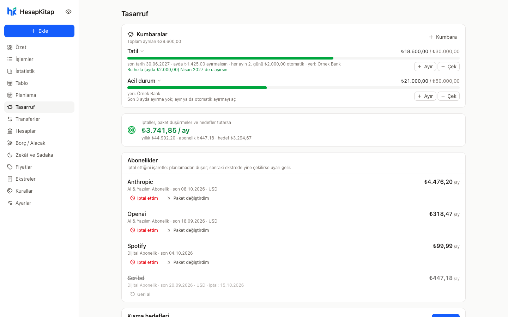

<p align="center">
  
</p>

<h1 align="center">HesapKitap</h1>

<p align="center">
  Kredi kartı ekstrelerini ve banka dökümlerini yükle, paranın nereye gittiğini gör, önümüzdeki ayları planla.<br>
  Zekât, sadaka, altın, kumbara ve faiz takibi dahil — Türkiye'deki bankalar ve alışkanlıklar için.<br>
  <b>Kendi sunucunda çalışır · verin sende kalır · telefonda uygulama gibi</b>
</p>

<p align="center">
  <a href="https://github.com/alameddinc/hesapkitap/actions/workflows/ci.yml"></a>
  <a href="LICENSE"></a>
</p>

<p align="center">
  
</p>

## İçindekiler

- [Neler yapar](#neler-yapar)
  - [Belgeleri içeri almak](#belgeleri-içeri-almak)
  - [Harcama, gelir ve plan](#harcama-gelir-ve-plan)
  - [Varlıklar, kumbara, borç/alacak](#varlıklar-kumbara-borçalacak)
  - [Zekât ve sadaka](#zekât-ve-sadaka)
  - [Faiz alarmı](#faiz-alarmı)
  - [Telefonda](#telefonda)
  - [Birden fazla kullanıcı](#birden-fazla-kullanıcı)
- [Hızlı kurulum](#hızlı-kurulum) · [tek tıkla / evde / VPS rehberi](docs/KURULUM.md)
- [Gizlilik](#gizlilik)
- [Geliştirme](#geliştirme)
- [Lisans](#lisans)

## Neler yapar

### Belgeleri içeri almak

- **Tek yükleme alanı** — Kart ekstresi mi, hesap dökümü mü, fiş mi, fatura mı kendisi anlar. PDF, fotoğraf, Excel/CSV.
- **Kart ekstreleri** — İşlemler, taksitler (kaçıncı taksit, kalan), dövizli harcamalar, faiz/BSMV/KKDF, vade farkı ayrıştırılır.
  Her ekstre **mutabakat kontrolünden** geçer: okunan işlemlerin toplamı ekstre özetiyle kuruşu kuruşuna tutmalı.
  - Hazır okuyucu: **VakıfBank**, **Kuveyt Türk**
  - Diğer bankalar: Gemini anahtarı varsa **yapay zekâyla okunur** (aynı mutabakat kontrolüyle)
- **Hesap dökümleri (vadesiz)** — Her satır **bakiye zinciriyle** doğrulanır (önceki bakiye + tutar = bakiye).
  VakıfBank "Hesap Hareketleri" yapay zekâsız, kuralla okunur (yıllarca hareket, ücretsiz); diğer bankalar yapay zekâyla.
  Maaş sabit kaleme bağlanır, kart ödemesi ekstreyi "ödendi" yapar, **kendi hesapların arası aktarım** gelir/gider sayılmaz,
  aynı hareket iki kez eklenmez, eski döküm güncel bakiyeyi ezmez.
- **Fiş ve fatura** — Fotoğraf çek (uzun fişte birkaç kare), tutar, tarih, işyeri, şube, ürün satırları, ödeme şekli,
  **taksit sayısı** ve yemek kartı markası okunur. Kredi kartıyla ödenen fiş ekstre gelince kart işlemiyle eşleşir; iki kez sayılmaz.
  Fişteki marka ile ekstredeki resmi unvan (ör. Espressolab ↔ NEW TASTE GIDA) öğrenilir.
- **E-posta otomasyonu** — Ayrı bir posta kutusuna yönlendirilen banka mailleri (e-ekstre, işlem bildirimi, hesap özeti) 10 dakikada
  bir içe aktarılır. Sadece banka alan adından gelen ve DKIM imzası doğrulanan mailler işlenir.
- **Telegram'dan** — Bota gönderilen PDF içe aktarılır (sadece bağlı sohbetten).
- **Şifreli PDF'ler** — Bankaların şifreli ekstreleri; şifre bir kez sorulur, hatırlanır.

### Harcama, gelir ve plan

- **Özet** — Dönem geliri/gideri/neti, "Dikkat etmen gerekenler", net durum, bütçeler, kategoriler, en çok harcanan yerler, ödemeler.
- **Ay dönümü** — Dönemler kart kesim tarihine hizalanır (ör. 20 Ekim – 19 Kasım "Kasım dönemi").
- **Otomatik kategori** — Kural tabanlı, düzelttikçe öğrenir; aynı işyerinin farklı bankalardaki yazılışları birleşir.
- **Bölme ve ortak harcama** — Bir harcamayı kategorilere böl ya da "300'ü Ali'nin payı" de: o kısım gider değil alacak olur.
  Fişte belirli ürünler (ör. sigara) kural ile ayrı kategoriye ayrılır; öneri formda onaylanır.
- **Taksitli alışveriş** — Elle/fişten girilen kart harcamasında taksit sayısı; her taksit kendi ayına gider yazılır,
  ekstre gelince ilk taksitle eşleşir.
- **Maaş** — **Brütten nete** (vergi dilimleri, asgari ücret istisnası, SGK tavanı) ay ay net. Zam / iş değişikliği kayıtları,
  vergi matrahının sıfırlanması, **peşin ödenen maaşta** (ör. kamu) zam farkının ilk zamlı maaşa eklenmesi.
  Dökümü olmayan geçmiş aylarda maaş **tahmini** sayılır ve işaretlenir; döküm gelince gerçeğiyle değişir.
- **Sabit kalemler** — Kira, aidat, abonelik… her ay plana girer, gerçekleşince gerçek tutarla onaylanır.
- **Planlama (3–12 ay)** — Kalan taksitler, abonelikler, faturalar, sabit giderler; **kesin** ve **tahmini** ayrı.
  **"Alırsam ne olur?"** simülatörü: taksit ve vade farkı maliyeti, önümüzdeki aylara etkisi.
- **Ödemeler** — Kart ekstreleri ve faturalar son ödeme tarihine göre; "Ödedim" (tam / asgari / kısmi), yeni ekstre gelince
  önceki kendiliğinden "ödendi". Eski (bankanın arşivinden önceki) dönemlerde ekstre yoksa karta yapılan ödeme o ayın
  tahmini kart harcaması sayılır.
- **İstatistik** — Geçen dönemlere göre gün gün / birikimli / haftanın günü / haftalar karşılaştırması, en yoğun günler
  (güne dokun, o günün harcamaları açılır), aylara göre gelir/gider, kart bazında, faiz geçmişi.
- **Tasarruf** — Abonelikleri iptal / paket düşürme olarak işaretle (iptal edilen yine çekilirse uyarı), kısma hedefleri ay ay "tuttu mu".
- **Bütçe** — Kategori limitleri, %80 ve %100 uyarıları.
- **Fiyat takibi** — Fişlerdeki ürünler ürün / mağaza / marka bazında; "bunu en ucuz nereden aldım", fiyat değişimi.
- **Tablo** — Excel gibi filtreler, kategori × ay pivotu, Excel'e aktarma.
- **Uyarılar** — Faiz, vade farkı, biten taksitler, limit doluluğu, dövizli harcama, eksik ekstre, maaşı görünmeyen aylar…

### Varlıklar, kumbara, borç/alacak

- **Hesaplar ve net durum** — Banka, nakit, yemek/hediye kartları, kredi kartı borçları, altın/döviz, borç/alacak → gerçek net durum.
  Bakiyeler dökümden kendiliğinden güncellenir ya da elle düzeltilir.
- **Altın ve döviz** — Çeyrek, gram, 22 ayar bilezik, Cumhuriyet, dolar, euro… anlık fiyatla değer; alış tarihi ve bedeli
  girilirse kazanç (TL ve %). Kimin olduğu (aile üyeleri) ayrı tutulur.
  - **"Ne zaman aldım?"** — Para çekimleri (ATM, gişe), giden havale/EFT ve kuyumcu harcamaları listelenir; seçince tarih ve tutar dolar.
  - **Miktarı bilinmiyorsa** — Ödenen tutar ve o günkü altın fiyatından **ihtiyatlı (fazla)** tahmin; "tartıp düzelt" işaretiyle.
- **Kumbara** — Bir hedef için para ayır (elle ya da her ay otomatik); para hesabında kalır ama **harcanabilir bakiyeden düşer**.
  Hedef ve son tarih varsa "ayda ne kadar" ve "bu hızla ne zaman ulaşırsın".
- **Yemek / hediye kartları** — Bakiye, aylık otomatik yükleme, son kullanma hatırlatması.
- **Borç / alacak defteri** — TL, döviz, altın; kısmi ödemeler, vadesinde hatırlatma, havale görülünce kendiliğinden kapanma,
  "vazgeçtim". **Transferler**: kime ne gitti, kişi kişi.

### Zekât ve sadaka

- **Zekât** — Diyanet (Hanefî) esas, Şâfiî seçeneği. Kişi bazında (aile üyeleri ayrı), **nisap** 80,18 gr altın,
  **kameri yıl** (354 gün) ve hicri tarih, %2,5.
  - Banka hesapları, alacaklar, altın/döviz otomatik; Hanefî'de vadesi bu yıl dolan borçlar ve kart ekstreleri düşülür.
  - Ziynet (takılan altın) ayrımı; yıl içinde bozdurup yeniden almak yılı bozmaz.
  - Erken / parça parça ödeme, yıl dolmadan 7 gün önce ve dolduğu gün Telegram hatırlatması.
  - **Geçmiş yıllar ve kaza zekâtı** — Geçmiş tarihlerdeki banka bakiyesi ve o günkü altın fiyatıyla her yıl yeniden hesaplanır;
    ödenmemiş görünen yıllar işaretlenir, Net durum'da borç olarak düşülür.
  - Kurallar sayfada sade dille; bilgilendirme amaçlıdır.
- **Sadaka ve bağış** — Sadaka, fitre, fidye, kurban, adak, kefaret, vakıf bağışı. Bilinen kurumlara (Diyanet Vakfı, Kızılay,
  Deniz Feneri, İHH, LÖSEV, Darüşşafaka, AFAD…) giden ödemeler yakalanıp "sadaka mı, zekât mı?" diye sorulur; herhangi bir
  harcama "zekât" olarak işaretlenirse o yılın zekât ödemesine yazılır. Tutarlar varsayılan gizli.

### Faiz alarmı

- Ekstrede faiz, vade farkı ya da faize bağlı vergi varsa **nedeniyle birlikte** uyarır: önceki ekstre **kaç gün geç** ödendi,
  eksik mi ödendi, hangi taksitli alışverişe vade farkı eklendi. Önlem: otomatik ödeme talimatı.
- Hesaba faiz işlerse "arındırılacak" uyarısı. İstatistik'te dönem dönem faiz geçmişi.

### Telefonda

- **Uygulama gibi** — "Uygulamayı yükle" düğmesi (Android/masaüstü Chrome, Edge); iPhone'da Ana Ekrana Ekle.
  Yeni sürüm öne gelince kendiliğinden yüklenir. Açılışta tutarlar gizli (göz ikonuyla açılır).
- **Paylaş ile gönder** — Banka uygulamasındaki ekstre PDF'ini ya da galerideki fiş fotoğrafını Paylaş menüsünden gönder:
  - **Android:** yüklü uygulama Paylaş menüsünde görünür.
  - **iPhone:** imzalı Kısayol tek dokunuşla eklenir (kişisel erişim anahtarıyla; anahtar sadece dosya göndermeye yarar).
  - Ekstre ve dökümler hemen içe aktarılır; fiş ve faturalar Özet'te "onay bekliyor" olarak bekler.
- **Telegram** — Son ödeme ve zekât hatırlatmaları, ay sonu raporu, günlük **şifreli** yedek.

### Birden fazla kullanıcı

- Arkadaşlarına **davet bağlantısı** ya da geçici şifreyle hesap aç. Her kullanıcının verisi **ayrı bir SQLite dosyasında**;
  yönetici ekranında sadece kullanıcı adı, son giriş ve yapay zekâ kullanımı görünür, kimsenin harcaması görünmez.
- Yöneticinin Gemini anahtarı paylaşılır, kişi başı **aylık okuma kotasıyla** (varsayılan 100); kendi anahtarını giren sınırsız.
- Başlarken rehberi: ekstre yükle → bakiyeleri kontrol et → maaş (net/brüt) → fiş okut → bildirimler.

<p align="center">
  
  
</p>

## Hızlı kurulum

### Tek tıkla, kendi sunucunda

Teknik bilgi gerekmeden kendi HesapKitap'ını kur, telefondan kendi adresinle kullan:

[](https://render.com/deploy?repo=https://github.com/alameddinc/hesapkitap)

Railway, Fly.io, evdeki cihaz (CasaOS, Unraid, Synology, Raspberry Pi — hazır imaj `ghcr.io/alameddinc/hesapkitap`)
ve kendi VPS'in için adım adım rehber: **[docs/KURULUM.md](docs/KURULUM.md)**

### Bilgisayarında Docker ile

Gereken tek şey [Docker](https://docs.docker.com/get-docker/).

```bash
git clone https://github.com/alameddinc/hesapkitap.git
cd hesapkitap
docker compose up -d
```

→ **http://localhost:8080** — ilk açılışta yönetici hesabını oluştur, bitti.

Gemini (fiş/fatura/ekstre okuma) ve Telegram (hatırlatma) anahtarlarını **Ayarlar → Anahtarlar** sayfasından girersin;
`.env` dosyasıyla uğraşman gerekmez.

**Denemek için örnek belgeler:** [`docs/demo/`](docs/demo/) — uydurma ekstre PDF'leri (VakıfBank, Kuveyt Türk,
yapay zekâ ile okunan "Örnek Bank"), fiş fotoğrafları ve fatura; adım adım 5 dakikalık demo akışı orada.

Ya da hazır demo verisiyle bak:

```bash
docker compose exec hesapkitap python -m app.demo
```

### Sunucuya kurulum

Aynı `docker compose up -d`; önüne HTTPS yapan bir reverse proxy (Caddy, Nginx, Traefik, Cloudflare Tunnel) koy.

- Uygulamayı internete açıp kurulumu yapmadan bırakma: yerel ağ dışından ilk kurulumda container log'undaki
  tek seferlik kod istenir (`docker compose logs | grep kurulum`).
- Şifreler PBKDF2 ile hash'lenir; oturum çerezi HttpOnly + (HTTPS'te) Secure, imzalı ve şifre değişince geçersiz olur;
  hatalı girişlerde 15 dakika kilit.
- Sunucu yöneticileri ayarları `.env` ile de verebilir (bkz. [`.env.example`](.env.example)); `.env` uygulama içindekinden önceliklidir.
- Veri: `./data` — `system.db` (kullanıcılar, davetler), `ekstre.db` (yönetici), `users/<id>/` (diğer kullanıcılar),
  yüklenen dosyalar ve gece yedekleri. Yedeklemek için bu klasörü kopyalaman yeterli.
- **iPhone kısayolu** kendi adresin için (macOS gerekir): `python3 scripts/make_shortcut.py https://alanadin` →
  çıkan dosyayı `data/shortcuts/hesapkitap.shortcut` olarak koy; Ayarlar'daki "Kısayolu ekle" düğmesi onu verir.

## Ekran görüntüleri

| Planlama | Tablo (pivot) |
|---|---|
|  |  |

| Tasarruf |
|---|
|  |

## Gizlilik

- **Kendi sunucunda** tüm veri o sunucuda, SQLite dosyalarında durur. Dışarıya sadece senin açtığın özellikler konuşur:
  - Gemini anahtarı girersen fiş, fatura ve tanınmayan bankaların ekstreleri okunmak için Google'a gider.
    Tanınan bankaların (VakıfBank, Kuveyt Türk) ekstreleri ve VakıfBank hesap dökümü sunucuda okunur, dışarı çıkmaz.
    Google AI Studio'da faturalandırmayı açarsan (ücretli katman) içerik model eğitiminde kullanılmaz.
  - Anlık ve geçmiş altın/döviz fiyatı için sadece fiyat sorgulanır (finans.truncgil.com, Yahoo Finance); kişisel veri gitmez.
  - Telegram'a giden yedekler AES ile şifrelidir; açmak için: `python -m app.backup decrypt dosya.db.enc`
- **Başkasının sunucusunda hesabın varsa** verin sana ait ayrı bir dosyadadır ve uygulamada yöneticinin onu görebileceği
  bir ekran yoktur; ama sunucuyu işleten kişi dosyaya teknik olarak erişebilir. Güvendiğin birinin sunucusunu kullan ya da kendininkini kur.
  Verini istediğin an Ayarlar → Yedekler'den tek dosya olarak indirebilirsin.
- Kart numaraları sadece maskeli (ilk 4 + son 4) saklanır. Paylaş kısayolunun anahtarı sunucuda sadece özet (hash) olarak tutulur.

## Geliştirme

```bash
cp .env.example .env            # isteğe bağlı
docker compose -f docker-compose.dev.yml up --build
```

→ http://localhost:5173 (Vite, sıcak yenileme) · API http://localhost:8000

```bash
docker compose -f docker-compose.dev.yml run --rm api pytest -q
```

| Yol | Ne |
|---|---|
| `app/parsers/` | Kart ekstresi okuyucuları + yapay zekâ yedeği |
| `app/bank_pdf.py`, `app/bank_import.py` | Hesap dökümü: kural tabanlı okuyucu, bakiye zinciri, içe aktarma |
| `app/categorize.py` | Varsayılan kategori kuralları |
| `app/finance.py` | Özet, planlama, uyarılar, faiz alarmı, istatistik |
| `app/zakat.py`, `app/donations.py` | Zekât (nisap, kameri yıl, geçmiş yıllar), varlıklar, sadaka |
| `app/payroll.py` | Brütten nete maaş |
| `app/system.py`, `app/auth.py` | Kullanıcılar, davetler, oturum, kota, erişim anahtarları |
| `app/share.py` | Telefondan Paylaş |
| `app/api/main.py` | FastAPI uçları |
| `web/` | React + Vite + Tailwind arayüzü |
| `tests/fixtures/` | **Uydurma** ekstre metinleri (gerçek veri yok) |

**Yeni banka eklemek** en değerli katkı — rehber: [CONTRIBUTING.md](CONTRIBUTING.md)

## English

HesapKitap is a self-hosted personal finance app built for Turkish banks: upload credit card statements and bank account
PDFs (exact parsers for VakıfBank and Kuveyt Türk, Gemini fallback for others, all verified by reconciliation and balance-chain
checks), snap receipts, auto-categorize, plan the coming months with gross-to-net salary, track gold/FX holdings, savings jars,
debts, zakat (Hanafi/Shafi'i, lunar year, missed years) and charity, get interest alarms with their cause, share files from
iPhone/Android, and invite friends with fully separate per-user databases. Quick start: `docker compose up -d` →
http://localhost:8080. Source-available under the PolyForm Noncommercial License 1.0.0: free for personal and other
noncommercial use; commercial use requires a separate license from the author.

## Lisans

[PolyForm Noncommercial 1.0.0](LICENSE) — kaynağı açık, **ticari olmayan** her kullanım serbest: kendin için kurup
kullanabilir, değiştirebilir, arkadaşlarınla paylaşabilirsin. Ticari kullanım (ücretli hizmet sunmak, bir şirket ürününe
gömmek vb.) için yazardan ayrıca izin/lisans gerekir.

Bu değişiklikten önce MIT ile yayımlanmış sürümler MIT lisansıyla kalır; yeni lisans bundan sonraki sürümler içindir.
